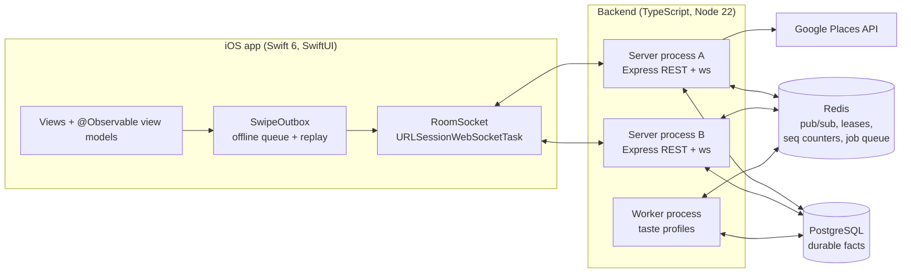

# Huddle

**A real-time group decision app.** Friends join a room with a code, everyone swipes on the same deck of nearby restaurants, and a game-show style reveal shows the one place the whole table said yes to.

iOS client in Swift 6 / SwiftUI. Backend in TypeScript on Node, PostgreSQL and Redis, built to stay correct when it runs as more than one server process.

> **Status:** feature-complete for v1 and verified on simulators. Not on the App Store yet. Remaining work is Sign in with Apple, backend deployment and TestFlight.

<!-- TODO: add a 30-60 second demo GIF or video link here. Two simulators side by side, join -> swipe -> reveal. -->

## How it works

1. The host creates a room and shares a 6-character join code. The lobby is the approval gate: the host sees who joined and can kick before starting.
2. On start, the server generates one shared deck (Google Places, Montreal) and freezes the roster for the round.
3. Everyone swipes. Votes stay secret while the round is active; only progress is broadcast.
4. When everyone is done, or nobody has acted for a while, the server tallies. A place matches only if **everyone** on the roster said yes.
5. The server directs the reveal. Ties go to a simultaneous hidden pick; zero matches triggers one overtime round with a fresh deck, then a graceful "no result".

```
LOBBY -> ACTIVE -> TALLY -> REVEALING -> MATCHED | NO_RESULT
```

Every state has a guaranteed exit. The host can close the room at any time.

## Architecture



Two rules shape everything:

- **Postgres holds facts, Redis holds only what can be rebuilt.** Redis runs without a volume on purpose. If losing Redis would lose a fact, the fact is stored in the wrong place.
- **The engine never knows the content.** The decision engine works with a `Candidate` (title plus opaque metadata). Restaurants live behind a `CandidateProvider`, so dishes or travel spots can use the same engine later.

## Engineering highlights

Each of these was built the same way: write the naive version, show it breaking under concurrency, then fix it. The broken versions are kept in git history on purpose, and each fix has an automated probe.

| Problem | Naive version (in history) | Fix | Probe |
|---|---|---|---|
| Two servers both see "everyone finished" and settle the same round twice | `54b7404` double-settled 4 of 5 trials, once rewinding a MATCHED room | Every state transition is a conditional `UPDATE` that carries its own precondition. The row is the arbiter: no locks, no leader | `verify-settle-race.ts` |
| Clients on different server processes stop seeing each other's events | `2caf7ec` split-brain demo | Redis pub/sub fan-out, per-room sequence numbers from a Redis counter, subscribe-before-snapshot to close the reconnect window | `verify-fanout.ts` |
| A killed process leaves "ghost" participants online forever | `059bef5` event-based presence | Presence is a TTL lease renewed by heartbeat; a sweeper broadcasts when leases expire without an event | `verify-presence.ts` |
| A room where everyone disconnected stays ACTIVE forever | `7cdaf62` per-process timer | One leased sweeper per cluster (`SET NX PX` plus a Lua check-and-renew) scans all active rooms; survives `SIGKILL` of the leader. The lease only picks who fires, correctness still comes from the conditional UPDATE | `verify-timeout.ts` |
| Swipes lost or double-counted on a bad connection | `504c192` fire-and-forget | iOS `SwipeOutbox` queues and replays on reconnect (at-least-once); the swipes primary key `(room, round, user, candidate)` makes replays count once | `SwipeOutboxTests`, `verify-live.ts` |

Other decisions worth reading the code for:

- **Frozen roster.** The tally denominator is the roster at round start, written in the same transaction as the state transition and deck generation. A Wi-Fi blip never changes who has to agree.
- **Cross-language wire contract.** `fixtures/*.json` are asserted byte-for-byte by the TypeScript builders and decoded by Swift tests. A protocol change has to pass both.
- **Recommendations off the hot path.** Laplace-smoothed taste profiles are rebuilt by a separate worker through a Redis job queue. Dealing a deck only reads cached profiles; a cache miss means a neutral cold start, never an inline rebuild. Group scores use least-misery aggregation, because under a full-consensus rule a card one person will reject can never win.
- **Account deletion anonymizes, never cascades.** Group history belongs to the group.
- **Google Places stays server-side.** The API key never ships in the client; results are cached per ~1 km grid cell in Redis for 6 hours.

## Repository layout

```
Huddle/            iOS app: features (Home, Lobby, Deck, History), networking, outbox
HuddleCore/        Swift package: RoomState machine, Room, Candidate, CandidateProvider
HuddleTests/       Swift Testing: outbox behaviour, wire contract
backend/
  src/             Express + ws server, settlement, timer, presence, Places provider
  src/reco/        scoring, profiles, job queue
  src/worker.ts    separate worker process
  migrations/      hand-written SQL, applied in order
  scripts/         end-to-end probes (verify-*.ts)
fixtures/          shared JSON fixtures tested by both Swift and TypeScript
```

## Running locally

Requirements: Node 22+, Docker, Xcode 16+.

```bash
cd backend
cp .env.example .env          # optional: add GOOGLE_PLACES_API_KEY, otherwise a mock deck is used
docker compose up -d          # Postgres 16 + Redis 7
npm install
npm run migrate
npm run dev                   # API + WebSocket on :3000
npm run worker                # in a second terminal
```

Then open `Huddle.xcodeproj` and run the `Huddle` scheme. Debug builds talk to `localhost:3000`. Run two simulators to play a room against yourself; a solo room also works end to end.

## Tests

```bash
# Backend unit tests (state machine, scoring, Places mapping, wire fixtures)
cd backend && npm test

# End-to-end probes. verify-live runs against the dev server;
# the multi-process probes spawn their own server clusters.
npx tsx scripts/verify-live.ts
npx tsx scripts/verify-settle-race.ts
npx tsx scripts/verify-timeout.ts
```

Swift tests run from Xcode (`Cmd+U`) or with `swift test` inside `HuddleCore/`.

## Tech stack

**iOS:** Swift 6 with strict concurrency, SwiftUI, `@Observable` MVVM, `URLSessionWebSocketTask`, Swift Testing, SPM
**Backend:** TypeScript, Node 22, Express 5, `ws`, raw `pg` with hand-written SQL, `ioredis`, `node:test`
**Infrastructure:** PostgreSQL 16, Redis 7, Docker Compose, Google Places API (New)

## Roadmap

- Sign in with Apple (replaces the dev identity)
- Deploy backend, TestFlight, App Store review
- Learn from outcomes: weight matched winners above plain yes votes
- Parked for v2: majority-vote rooms, editable display names, re-invite from history

## Author

Han (Alex) Yue · [LinkedIn](https://www.linkedin.com/in/han-yue-75987aa8/) · [Portfolio](https://guillaumeyue.github.io/HanPortfolio/)
